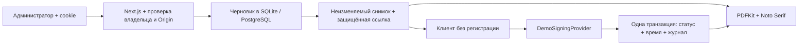

# Архитектура Qutty Qonaq (RentalSign)

Один Node.js-процесс Next.js: SQLite для локального запуска, внешний Neon PostgreSQL для бесплатного Render. Цель — показать законченный сценарий оформления аренды без реальной ЭЦП и без микросервисов. HTTPS завершается на Render; договоры, ссылки, сессии и журнал переживают рестарт приложения благодаря внешней базе.

## Слои

| Каталог             | Ответственность                                                        |
| ------------------- | ---------------------------------------------------------------------- |
| `src/app`           | Серверные страницы, App Router, Route Handlers                         |
| `src/components`    | Интерфейс RU/KK/EN, формы, предпросмотр, мобильная навигация            |
| `src/components/ui` | Локальные компоненты shadcn/ui: Button / Dialog, Radix accessibility   |
| `src/domain`        | Статусы, демопредупреждение, условия шаблона, форматирование           |
| `src/catalog`       | Только проверенные публичные данные квартир и пути обработанных фото |
| `src/services`      | Создание, редактирование, ссылки, отзыв, копирование, публичное чтение |
| `src/repositories`  | Выборки договоров с обязательным ownerId, создание снимка объекта      |
| `src/signing`       | Интерфейс SigningProvider и DemoSigningProvider                        |
| `src/pdf`           | Генерация A4 в памяти с кириллицей и нумерацией                        |
| `src/auth`          | scrypt, сессии, проверки страниц и API                                 |
| `src/validation`    | Строгие схемы Zod                                                      |
| `src/audit`         | Типизированные события без ФИО, телефонов и токенов                    |
| `src/lib`           | Prisma, криптография, лимиты, HTTP, конфигурация                       |

Для простого CRUD объектов используется Prisma непосредственно из Route Handlers; отдельный repository-класс не даёт практической пользы. Для договоров выделен слой выборок, поскольку проверка владения и снимки используются в нескольких сценариях.

Частный шаблон хранится JSON-строкой в `Admin.contractDefaults` и доступен через защищённый `/templates`. Сервер нового договора читает только шаблон вошедшего владельца, форма получает начальные реквизиты/условия и сохраняет их в собственном снимке. Старые документы и версии не зависят от дальнейших изменений шаблона. Удостоверения и адрес арендатора — необязательные поля контракта, совместимые с прежними снимками. Локальная очистка демоданных отделена от публичного и административного API: только явная команда подготовки SQLite с резервной копией. Подробности: [ADMIN_WORKSPACE.md](ADMIN_WORKSPACE.md).

Публичная витрина `/apartments` и карточки не читают приватную таблицу объектов: данные и WebP готовятся из предоставленной папки. Авторизованный POST связывает выбранную квартиру с объектом владельца через уникальную пару `ownerId/catalogSlug`; GET не изменяет БД. Цена карточки не переносится как итог договора. Состав снимков, защита ссылок и демоподписание сохраняются. Подробности: [CATALOG.md](CATALOG.md).

## Поток

Ссылка содержит случайный 256-битный bearer-токен. В БД хранится SHA-256 для поиска и AES-256-GCM ciphertext для повторного копирования администратором. Ключ находится вне БД. Сессионные токены хранятся только в виде хеша.

Даты поступают в ISO 8601 с offset, сохраняются в UTC; UI/PDF показывают Asia/Almaty. Форма вводит время Казахстана UTC+5 независимо от часового пояса компьютера. Деньги — целое число тенге, не число с плавающей точкой.

## Фиксация и конкурентность

Ссылка создаётся в транзакции: условное обновление revision, отзыв предыдущих ссылок, новый ContractVersion со снимком и хешем, SigningLink и AuditEvent. Черновик доступен для изменения только при `DRAFT` и совпадении revision. Отправленный договор блокируется независимо от результата демоподписания.

Демоподписание проверяет token, revokedAt, expiresAt и подтверждение ознакомления; затем условно меняет `PENDING → DEMO_SIGNED`. В той же транзакции записывается серверное время и одно событие. Только один одновременный запрос проходит условное обновление.

Изменения договоров используют Serializable и до трёх попыток при конфликте P2034. В PostgreSQL это также защищает от гонки подписания с отзывом или заменой ссылки; конкурентные сценарии проверены на реальной Neon-базе.

`EXPIRED` вычисляется на сервере по expiresAt; фонового задания для переписывания статусов нет. Срок ссылки проверяется при каждом публичном чтении, скачивании PDF и подписании. Даже подписанная версия не открывается по истекшей ссылке; администратор сохраняет доступ.

PDF генерируется из сохранённого снимка и signedAt по запросу. Файл не сохраняется в public и не является криптографически подписанным документом. Идентичность содержания обеспечивается снимком; побайтовая идентичность PDF между скачиваниями не гарантируется из-за метаданных генерации.

Оформление PDF основано на переданном владельцем образце: заголовок, реквизиты сторон, разделы объекта, условий и оплаты, статус и поля для возможных собственноручных подписей. Шаблон DOCX и персональные реквизиты из него не включены в приложение. Все поля и условия берутся из снимка конкретного договора; недостающие поля не подставляются из образца. Применяются встроенные Noto Serif Regular/Bold под SIL OFL. PDF генерируется заново, поэтому обновлённая вёрстка применяется также при повторном скачивании старых документов: их сохранённые снимки не изменяются, но PDF не является архивом прежнего оформления. Демо-статус и отсутствие ЭЦП обозначены явно; подписи в PDF не проставляются.

## Будущая замена

PostgreSQL-schema генерируется из канонических SQLite-моделей, миграции разделены по провайдеру. Перенос существующей локальной базы не выполняется автоматически. Доменная модель не зависит от SQLite SQL. Для НУЦ РК потребуется другой провайдер, дополнительные состояния, подтверждение личности, защищённое хранение результата, legal review и проверка подлинности — простая замена класса сама по себе этого не обеспечивает. Решение бесплатного размещения описано в ADR-002 и DEPLOYMENT.

## Языки, бренд и занятость

`LanguageProvider` читает проверенный выбор RU/KK/EN из cookie, словарь хранится в `src/lib/translations.json`. Публичные страницы рендерятся с учётом cookie на сервере; документы и данные пользователя автоматически не переводятся. Onest и Noto Sans отдаются локально. Бренд и интерфейс описаны в QUTTY_QONAQ.md.

`Availability` хранит диапазоны календарных дней и статусы отдельно от договоров. Публичный GET возвращает только даты/статус, управление требует сессии, Origin и проверки владельца объекта. Календарь не создаёт брони и не синхронизируется с договорами. Решение — [ADR-003](decisions/ADR-003-manual-availability.md).
