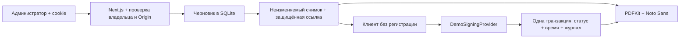

# Архитектура RentalSign

Один Node.js-процесс Next.js и локальная SQLite-база. Цель — показать законченный сценарий оформления аренды без реальной ЭЦП и без микросервисов.

## Слои

| Каталог             | Ответственность                                                        |
| ------------------- | ---------------------------------------------------------------------- |
| `src/app`           | Серверные страницы, App Router, Route Handlers                         |
| `src/components`    | Русский интерфейс, формы, предпросмотр, мобильная навигация            |
| `src/components/ui` | Локальные компоненты shadcn/ui: Button / Dialog, Radix accessibility   |
| `src/domain`        | Статусы, демопредупреждение, условия шаблона, форматирование           |
| `src/services`      | Создание, редактирование, ссылки, отзыв, копирование, публичное чтение |
| `src/repositories`  | Выборки договоров с обязательным ownerId, создание снимка объекта      |
| `src/signing`       | Интерфейс SigningProvider и DemoSigningProvider                        |
| `src/pdf`           | Генерация A4 в памяти с кириллицей и нумерацией                        |
| `src/auth`          | scrypt, сессии, проверки страниц и API                                 |
| `src/validation`    | Строгие схемы Zod                                                      |
| `src/audit`         | Типизированные события без ФИО, телефонов и токенов                    |
| `src/lib`           | Prisma, криптография, лимиты, HTTP, конфигурация                       |

Для простого CRUD объектов используется Prisma непосредственно из Route Handlers; отдельный repository-класс не даёт практической пользы. Для договоров выделен слой выборок, поскольку проверка владения и снимки используются в нескольких сценариях.

## Поток

Ссылка содержит случайный 256-битный bearer-токен. В БД хранится SHA-256 для поиска и AES-256-GCM ciphertext для повторного копирования администратором. Ключ находится вне БД. Сессионные токены хранятся только в виде хеша.

Даты поступают в ISO 8601 с offset, сохраняются в UTC; UI/PDF показывают Asia/Almaty. Форма вводит время Казахстана UTC+5 независимо от часового пояса компьютера. Деньги — целое число тенге, не число с плавающей точкой.

## Фиксация и конкурентность

Ссылка создаётся в транзакции: условное обновление revision, отзыв предыдущих ссылок, новый ContractVersion со снимком и хешем, SigningLink и AuditEvent. Черновик доступен для изменения только при `DRAFT` и совпадении revision. Отправленный договор блокируется независимо от результата демоподписания.

Демоподписание проверяет token, revokedAt, expiresAt и подтверждение ознакомления; затем условно меняет `PENDING → DEMO_SIGNED`. В той же транзакции записывается серверное время и одно событие. Только один одновременный запрос проходит условное обновление.

`EXPIRED` вычисляется на сервере по expiresAt; фонового задания для переписывания статусов нет. Срок ссылки проверяется при каждом публичном чтении, скачивании PDF и подписании. Даже подписанная версия не открывается по истекшей ссылке; администратор сохраняет доступ.

PDF генерируется из сохранённого снимка и signedAt по запросу. Файл не сохраняется в public и не является криптографически подписанным документом. Идентичность содержания обеспечивается снимком; побайтовая идентичность PDF между скачиваниями не гарантируется из-за метаданных генерации.

## Будущая замена

Для PostgreSQL потребуются новый datasource, миграции, перенос данных и повторные конкурентные проверки. Доменная модель не зависит от SQLite SQL. Для НУЦ РК потребуется другой провайдер, дополнительные состояния, подтверждение личности, защищённое хранение результата, legal review и проверка подлинности — простая замена класса сама по себе этого не обеспечивает.
